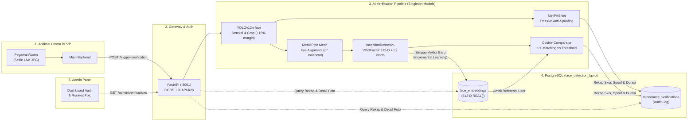
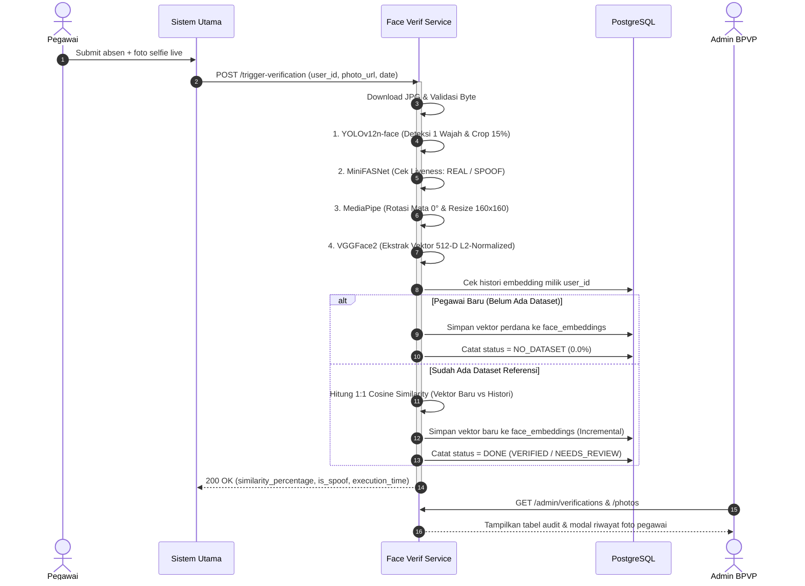
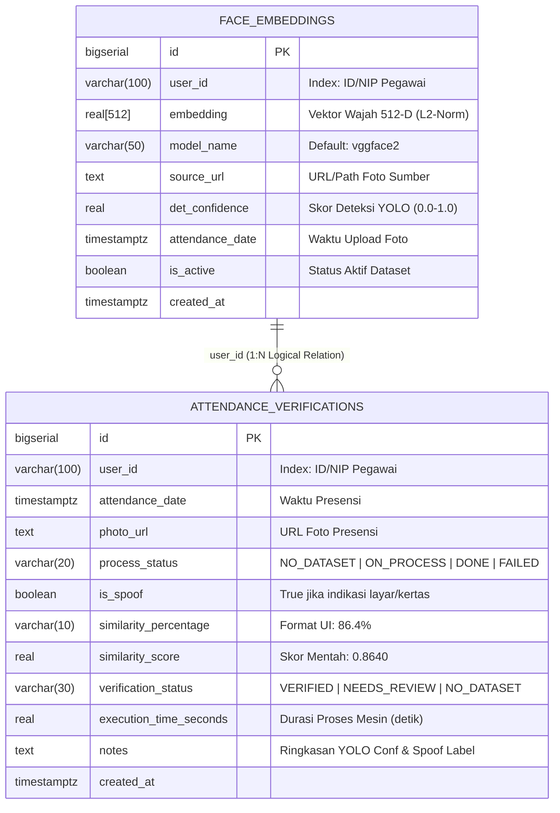

# Face Verification Service — BPVP

Microservice independen untuk **verifikasi biometrik wajah (1:1)** dan **passive liveness detection (anti-spoofing)** pada sistem presensi internal BPVP. Berjalan secara asinkron di latar belakang (*background audit service*) untuk menyuplai data analitik ke **Admin Panel** tanpa membebani aplikasi utama.

> 💡 **Interactive Architecture Workbench:** Buka visualisasi interaktif lengkap (Pan/Zoom, Node Inspector, Animasi Alur, & ERD) di [`docs/architecture.html`](docs/architecture.html).

---

## 1. Arsitektur Microservice

Service ini dirancang terpisah (*decoupled*) dari aplikasi presensi utama agar pemrosesan komputasi AI (PyTorch, YOLO, MediaPipe) hemat RAM/CPU dan mudah diskalakan.



### Keunggulan Desain (*Key Insights*)
- **Singleton Model Loading**: Seluruh bobot model AI dimuat satu kali ke memori saat startup, menjaga latensi verifikasi tetap rendah (~0.2–0.6 detik/foto).
- **Passive Auditing (Non-Blocking)**: Deteksi *spoofing* (layar HP/monitor atau kertas cetak) tidak memblokir absensi pegawai di lapangan, melainkan memberi penanda (`is_spoof: true`) agar Admin dapat melakukan audit secara objektif.
- **Incremental Learning**: Setiap foto presensi yang valid otomatis diekstrak menjadi embedding baru di database, sehingga akurasi pengenalan wajah pegawai semakin adaptif terhadap perubahan penampilan seiring waktu.

---

## 2. Alur Verifikasi Presensi

Siklus pemrosesan dari saat pegawai mengunggah foto presensi hingga tampil di dashboard Admin:



### Siklus Status Verifikasi
| Status Proses (`process_status`) | Status Hasil (`verification_status`) | Arti & Kondisi |
| :--- | :--- | :--- |
| `NO_DATASET` | `NO_DATASET` | Pegawai baru pertama kali absen; foto langsung dijadikan referensi awal. |
| `DONE` | `VERIFIED` | Kemiripan wajah $\ge$ threshold (`0.60` / `60%`). |
| `DONE` | `NEEDS_REVIEW` | Kemiripan wajah $<$ threshold atau memerlukan tinjauan manual Admin. |
| `FAILED` | `FAILED` | Foto rusak, tidak ditemukan wajah, atau terdeteksi lebih dari satu wajah. |

---

## 3. Skema Database & ERD

Menggunakan **PostgreSQL** (`face_detection_bpvp`). Vektor disimpan sebagai tipe native `REAL[512]` (siap dimigrasikan ke `pgvector` di masa depan), sedangkan kalkulasi *cosine similarity* dieksekusi di memori menggunakan NumPy.



> **Catatan Desain Database:** Atribut `det_confidence` hanya disimpan di `face_embeddings` (dan diringkas pada kolom `notes` di tabel audit) untuk menghindari duplikasi kolom antar-tabel.

---

## 4. Spesifikasi Endpoint API

Seluruh endpoint (kecuali `/health`) wajib menyertakan header autentikasi:
`X-API-Key: <API_KEY>`

| Method | Endpoint | Fungsi Utama |
| :--- | :--- | :--- |
| `POST` | `/trigger-verification` | **Webhook Utama**: Menerima `user_id`, `photo_url`, `attendance_date` dari sistem presensi. |
| `POST` | `/verify` | Uji verifikasi langsung menggunakan unggahan file `multipart/form-data` (JPG/JPEG). |
| `POST` | `/verify/base64` | Verifikasi langsung menggunakan payload JSON string Base64. |
| `POST` | `/face-datasets` | Pendaftaran (*enrollment*) kumpulan foto referensi awal pegawai via daftar URL. |
| `GET` | `/admin/verifications` | Mengambil daftar hasil audit presensi untuk tabel utama di Admin Panel. |
| `GET` | `/admin/verifications/{user_id}/photos` | **Action Detail**: Mengambil seluruh riwayat foto pegawai berdasarkan tanggal upload. |
| `GET` | `/health` | Cek status hidup server (*healthcheck* publik). |

---

## 5. Struktur Proyek & Instalasi Cepat

* `app/`
  * `main.py` — Entry point FastAPI, konfigurasi CORS, & registrasi router
  * `config.py` — Konfigurasi environment (`.env`), dimensi model, & threshold
  * `db.py` — Koneksi PostgreSQL (`psycopg3`) & query repositori
  * `security.py` — Validasi keamanan header `X-API-Key`
  * `routers/` — Endpoint `enrollment.py` & `verification.py`
  * `services/` — Pipeline AI (`detector.py`, `anti_spoofing.py`, `aligner.py`, `embedder.py`, `comparator.py`, `verifier.py`, `downloader.py`)
* `models/` — Bobot model lokal `yolov12n-face.pt` (diabaikan oleh Git)
* `datasets/` — Folder uji lokal `reference/` & `live_test/` (diproteksi penuh oleh `.gitignore`)
* `docs/architecture.html` — Visualisasi arsitektur interaktif mandiri (*Archify*)
* `schema.sql` — DDL inisialisasi tabel & hak akses PostgreSQL

### Menjalankan Layanan (Python 3.11)

```powershell
# 1. Buat & aktifkan virtual environment Python 3.11
py -3.11 -m venv venv
.\venv\Scripts\Activate.ps1

# 2. Pasang dependensi & siapkan konfigurasi
pip install -r requirements.txt
copy .env.example .env

# 3. Jalankan database schema di PostgreSQL (DBeaver / psql), lalu nyalakan server
uvicorn app.main:app --reload --port 8001
```

- **Base URL**: `http://localhost:8001`
- **Swagger UI**: `http://localhost:8001/docs`
